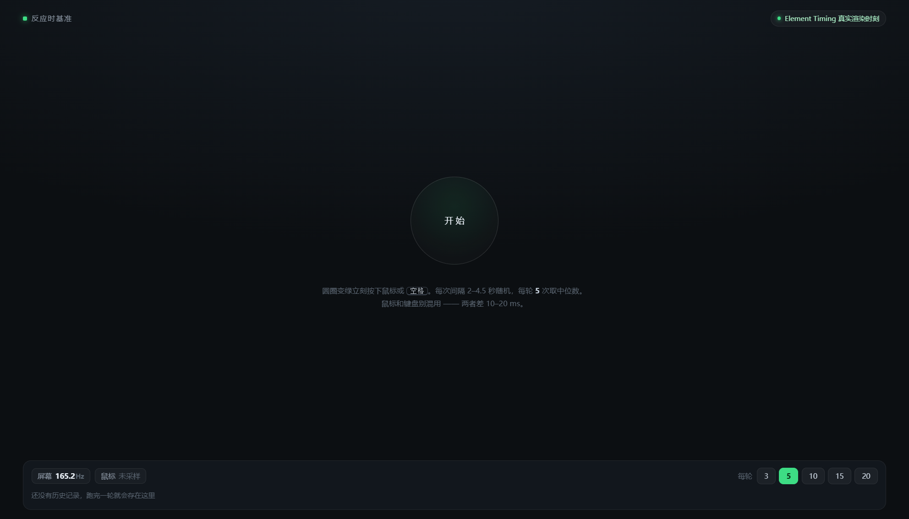

# 反应时基准（reaction-bench）

单文件网页，双击就能测，用来代替 humanbenchmark / arealme 那两个在线反应测试。

- 在线版：https://akaneranma.github.io/reaction-bench/
- 本地版：在这个目录下直接双击 `index.html`（`file://` 打开也照常工作，ET 与 localStorage 都实测可用）



## 为什么自己写一个

两个站点测出来差很多，不是你的问题，是它们的计时口径不一样。我把两家的前端代码扒下来看过：

| | humanbenchmark | arealme |
| --- | --- | --- |
| 计时方式 | `new Date()` 在 React reducer 里取时刻 | `performance.now()` |
| 变绿到开始计时 | 改 DOM → setTimeout → reducer 里取时间，比上屏晚 | 改完 DOM 同一个任务里取时刻，比上屏早整整一帧 |
| 显示值 | 实测间隔，基本如实 | `(now - turnedAt) * 0.8`（源码里 `bt=.8`，只用在 press 处理器） |
| 轮数 | 固定 5 | 可选 3/5/…/100 |
| 等待时间 | 2.5–5 s | 2–4 s |

也就是说 **arealme 把每个读数乘了 0.8**。同一个 165 ms 的手速，在那边显示 132 ms，还会给你判个"人类奇迹"。同一台机器实测：本页 168.8 / HB 172 / arealme 132（×1.25 = 165），三家夹逼的真值约 165 ms —— HB 那 2% 的偏差来自 `new Date` 取晚，arealme 那 20% 是写死在代码里的。

## 这个页面怎么测

**用 Element Timing 拿"真正上屏"的时刻。** 不是 `requestAnimationFrame`，也不是 `setTimeout`。

变绿那一帧的目标元素带 `elementtiming` 属性，浏览器渲染完会给一条 PerformanceEntry，`renderTime` 就是它被合成器画到屏幕上的时刻；按键时刻用事件自带的 `event.timeStamp`（与 performance.now 同源）。两端都取自同一条时间轴，读者就是"眼睛看到绿 → 手指按下"。

rAF 口径会偏大约 3 帧（本机 165 Hz 实测 +20.9 ms），因为帧回调发生在合成之前。所以本页优先用 Element Timing，取不到才回退 rAF 并在状态徽章上标黄。

**隐形锚点**：绿色圆盘上有个 `div.stim`，内容是 `··`，`opacity: .01`、色值同底色、`pointer-events: none`。肉眼完全看不见（4 倍放大截图验证过），但 Element Timing 照常出 entry。踩过的坑：`color: transparent`、`rgba(0,0,0,0)`、`visibility: hidden`、`left: -9999px` 这几种浏览器直接不给 entry；必须是 **block 级元素 + 有文字被真正绘制**。inline 的 `<span>` 也不给。

## 读数怎么算

- 每轮默认 5 次（可切 3/5/10/15/20），**结果页大数字是中位数**，不是均值。均值会被一次走神拉飞（arealme 那张图上 4507 ms 就是这么来的）。
- 最快 / 平均 / 最慢 / 次数 四张卡都给，SD 也显示。
- 小于 110 ms 或大于 3 s 的异常单次会单独标出来，抢跑（绿灯之前点）单独计次，不进成绩。
- 百分位对照用 humanbenchmark 的直方图（70,940 个样本，40 个桶）：`REF = [[118,99.8],[132,99.5],[147,98.9],[165,94.9],[172,93.1],[180,88.8],[208,67.5],[250,32.9],[300,18],[350,9],[450,2.5],[600,0.8]]`，线性插值。

## 结果页左右那两张卡

`HB ≈ 本页中位 × 1.02`、`arealme ≈ 本页中位 × 0.79`。

系数是同一台机器上实测标定的（168.8 → 172 / 132），不是猜的。它只跟两个站点自己的计时偏差有关，跟你的刷新率无关，所以换台机器也大致成立。

**为什么不画"换算到 60 Hz 标准设备"的预测曲线**：标准设备定成了本机的 165 Hz，那条线就等于实测值，画出来是条重合的线，没有信息量。要是以后需要在 75 Hz / 120 Hz 机器之间对比，把 `std60Of()` 那条接回 `chart()` 的 `pred` 参数即可。

## 顶部两个实时读数

- **屏幕刷新率**：采 60 帧，只留 `1 < d < 100` ms 的帧间隔（滤掉跨时钟跳变的假值），排序去掉上下各 10% 取均值反推。连测两个窗口取高值，低值不覆盖已验证的高值（连续 2 次低于 93% 才更新）。渲染忙的时候会掉帧，这时读数偏低于真实值。
- **鼠标回报率**：`getCoalescedEvents()` 拿被合并的原始事件，相邻 `timeStamp` 取中位数反推。1000 Hz 鼠标会稳定读到 1000 左右。没晃鼠标时显示"未采样"。

## 历史记录

存在 `localStorage` 的 `rt-fair.v1`，最多 400 轮，按天分组，底栏显示最近几天的曲线（带 max / 均值 / min 三条参考线和序号）。"清空"按钮在右下。

## 使用要求（重要）

- 用 Chrome / Edge 打开，**窗口必须在前台且不被遮挡**。被遮挡或最小化后 Chrome 会停掉 `requestAnimationFrame` 和 Element Timing，这一帧就测不出起始时刻，页面会提示"这一帧没画出来，把窗口拉到前台再测"，这一次不算数。
- 别开录屏 / 高负载任务；笔记本断电降频也会影响读数。
- 眼睛盯着圆盘，不要看键盘；圆盘由红变绿的那一刻点。

## 已知局限

- 118 ms 左右已经贴到视觉通路的生理下限（视网膜 → LGN → V1 → 运动皮层 → 手），单次蹦出这种数字当噪声看。
- 这里测的是"从像素上屏到鼠标事件被浏览器收到"，不含显示器自身的像素响应延迟（IPS 通常 3–8 ms，VA 更久）和你手指的机械行程。所以真值比本页读数还会再高一点点。
- 用无线鼠标 / 蓝牙鼠标，链路延迟会实打实算进去。
- 换机器、换浏览器比绝对值意义不大，看自己同一台设备上的趋势。

## 文件

```
index.html         页面本体（单文件，无外部依赖；GitHub Pages 直接托管这个文件）
shots/idle.png     空闲态
shots/testing.png  测试中（顶部进度 + 圆盘上方"等待变绿" + 底部实时曲线）
shots/result.png   结果页（左右站点预测卡 + 主图 + 四卡 + 百分位刻度）
tools/syncheck.cjs 语法自检（node tools/syncheck.cjs index.html）
```

改完页面推一次就行：

```
git add -A && git commit -m "tweak" && git push
```

Pages 会自动重建，一两分钟后 https://akaneranma.github.io/reaction-bench/ 生效。手机浏览器扫这个地址即可，但注意 README 下面说的"换设备不可比"。

## 附：抓包备份说明

当初为核对两个站点的实现，下载过 `hb.js`（728 KB）、`arealme.js`（34 KB）和页面 HTML，核对完已随测试数据一起清理。结论留在上面那张表里；要复现就重新抓一次：
```
curl.exe -o hb.js https://humanbenchmark.com/assets/index-BOhEtgge.js
curl.exe -o arealme.js https://areal.me/static/libs/reaction-test-v3.20261009a.js
```
arealme 的关键一行是 `bt=.8`，以及 press 处理器里的 `let s=(e-this.turnedAt)*bt`。
